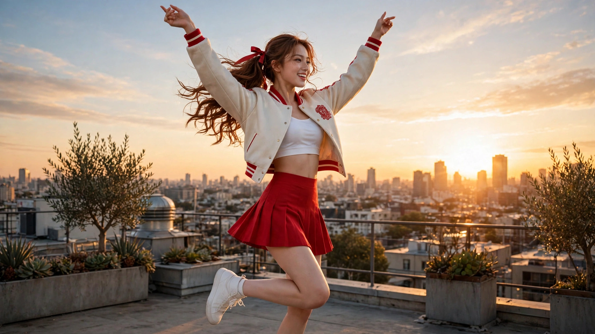
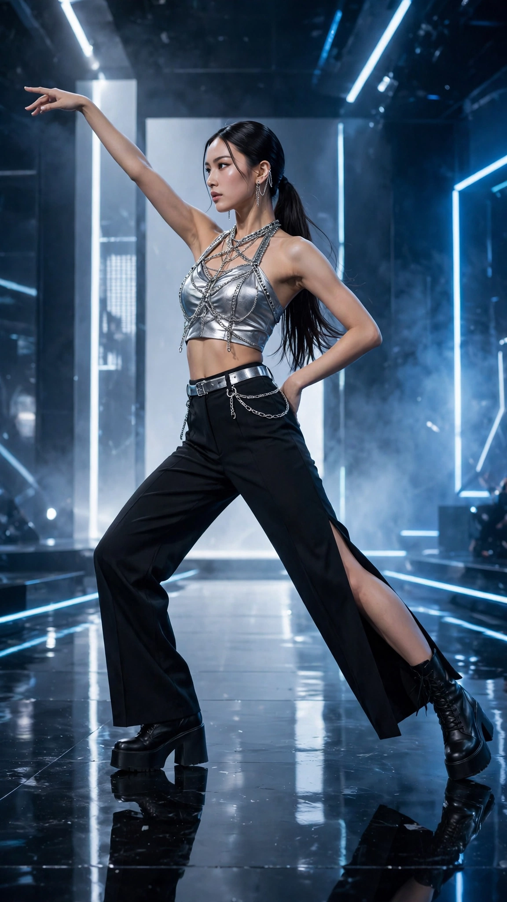
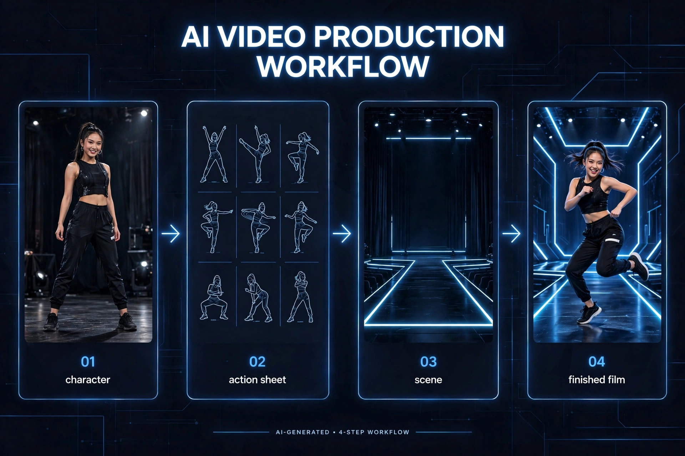
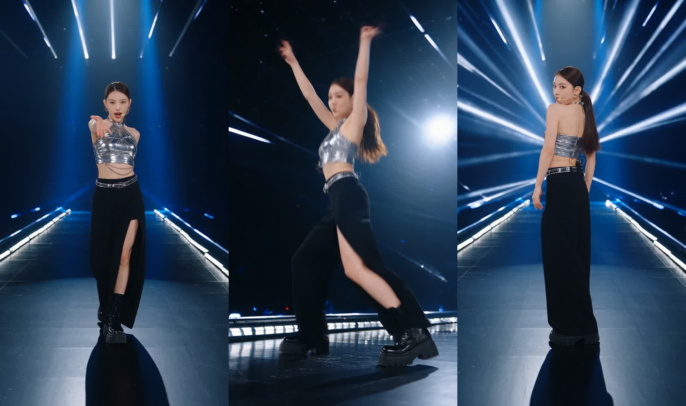

# 声舞短片

**一句话，让 AI 完成一支 30 秒声舞短片。**

做一条 30 秒的日落天台 K-pop：棕色长卷发的女团成员在城市天台上跳完一支短片。
就这一句话。音乐、歌词、口型、舞蹈、摄影机，同在一条时间码上，一次出片。

这是声舞短片。声、舞、镜一体，不是先做动作再配音乐，也不是先定音乐再贴动作——歌从哪句起，脚步就从哪拍落；副歌到哪句，镜头就切到哪。

## 一、声舞短片是什么

一句话，做一支声舞短片。它是给 AI 影像创作者用的工作流，也是我自己的出片方法。

一支成片的标准只有一条：音乐和舞蹈全程连续不断。拼几段各跳各的、音乐断一下再接上，不算成品。

它管四件事：

- **音乐先行**：先把整段音乐定下来，动作按它的拍子编。没有音乐，就没有舞蹈。音乐决定舞姿，画面决定造型和场景，两条轴分开。
- **歌词按真唱核算**：歌词先按真实演唱速度算字数，再定 BPM，不硬塞。
- **人设一次锁定**：人物、发色、妆容、服装、鞋子，全片不变。服装要能动，舞台造型成套配色统一。
- **摄影机同时间码**：每段一个主要运镜，峰值和动作同步。
- **呈现标准**：舒展、自然、唯美。僵硬、机械、逐拍顿挫直接返工。

*定妆照：先出全身定妆照，脚在画内，确认造型再开拍。*

## 二、它怎么出片

从一句话到成片，一共七步：

1. **定音乐**：曲风、BPM、歌词。歌词先算好字数，再定拍子。
2. **定人设**：先出定妆照，全身入镜、脚在画内，确认造型再开拍。
3. **定 Hero**：全片只留 1 个招牌动作，优先转身、定格、招牌舞步。
4. **编动作链**：按乐句切段，每段一个主动作，上一段的收尾必须能接下一段的起势。
5. **出片**：单次生成 15 秒，30 秒的片子分两段出。
6. **接长片**：上一段的末帧当下一段的首帧，同一场景、同一人、同一套衣服；接点必须大切镜，换角度、换景别，在重拍上硬切。
7. **QC**：逐段抽帧验身份、服装、脚步和接点，口型、音乐、舞蹈三条线对不上就返工。

默认视频模型是 Seedance 2.0 Fast。一次生成，带原生音频。

## 三、舞种

舞种按需换，K-pop 女团舞只是其中一种模式，不是全部：

- **K-pop 女团**：Point Choreo、队形、回眸、优雅转身
- **Hip-hop / Popping**：Groove、肩胸控制、Freeze、身体隔离
- **House**：快速脚步、连续重心转移
- **Waacking**：手臂线条、舞台张力
- **宅舞 / 偶像舞**：可爱、洗脑、短视频挑战
- **古风 / 古典**：身韵、云手、袖舞
- **多人群舞**：队形、速度差、遮挡交接
- **说唱舞**：中文说唱 + 舞蹈，歌词 Flow 先行

## 四、一条 30 秒片子的时间码

- **0–4 秒**：前奏，脸先入镜，一个清晰招牌动作
- **4–15 秒**：主歌进副歌，脚步和上肢建立，招牌舞步
- **15 秒**：大切镜，换角度、换景别，在重拍上硬切
- **15–26 秒**：副歌高潮，全身远景接低角度中景
- **26–30 秒**：收尾减速 + 定格，面向镜头

每段一个主要运镜，峰值同步。只保留 1 个核心 Hero，最多 1 次完整旋转。

*成片实拍帧。*

## 五、长片怎么接：末帧续接 + 大切镜

单次生成 15 秒，30 秒的片子分两段接，40 秒以上照此重复，也是我实测沉淀下来的：

1. 整段音乐先设计好，两段共用一条音乐，动作都按它的拍子编。
2. 生成第一段，记下它的末帧姿势。
3. 抽出末帧当第二段的首帧参考，第二段从这个姿势起跳，场景、人物、服装、BPM 全不变。
4. **接点必须大切镜**：同位置接一定会跳帧。上一段以远景收尾，下一段从另一个方向的近景起步，再切回来，重拍上硬切，不加转场。
5. 硬拼在一起，静音原声，底下铺一条完整的全长音乐。
6. 30 秒、40 秒照此重复，每次接点都换方向、换景别。

## 六、踩过的坑

- **拼接断音乐不算成品**：两段各跳各的拼起来，音乐一断，整条就不成立。
- **朗读不是唱**：TTS 配音念歌词，听起来是读不是唱，做唱跳必须真唱人声。
- **口型最难**：视频模型自己猜嘴型，跟歌声对位是这条路目前最难的一环，正在持续打磨。
- **造型不能将就**：羽绒服加短裤上舞台，再好的动作也救不回来。人物标准是 172cm、九头身、长腿、修身舞者体型，造型先过关再开拍。

## 七、怎么用

这是一份 skill 文档，不是代码插件。用法：

1. 把 `SKILL.md` 放进你的 agent 的 skills 目录（或直接发给你的 AI 助手当作工作流），或者直接把开源地址给你的 Agent，让他帮你下载安装。
2. 按第二节的七步走：定音乐 → 定人设 → 定 Hero → 编动作链 → 出片 → 接长片 → QC。
3. 完整规则见 [`SKILL.md`](SKILL.md)，包括舞种路由、15 秒 / 30 秒结构、动作模块、人物设计标准和输出格式。

第一个版本，在使用过程中有任何问题，欢迎来提建议。
用它做出了自己的片子，欢迎发出来 @ 我（@Hugh96Mh），我很想看。觉得有用的话，给仓库点个 star 就是最大的鼓励。

想做产品概念短片、创意短片合作，欢迎私信。

---

*声舞短片 v1.3.0｜声、舞、镜一体，音乐、歌词、口型、舞蹈、摄影机同时间码。*
